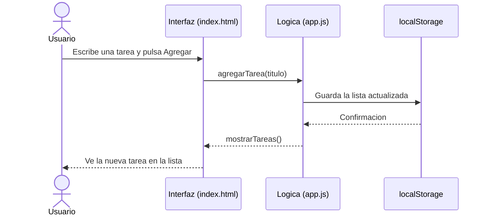

# Gestor de Tareas
 


 
Aplicacion web para organizar las tareas del dia: agregarlas, marcarlas
como hechas y filtrarlas por estado. Pensada para estudiantes que
quieren llevar el control de sus entregas sin instalar nada; las tareas
se guardan en el propio navegador.
 
## Tabla de contenidos
 
- [Tecnologias](#tecnologias)
- [Instalacion](#instalacion)
- [Uso](#uso)
- [Estructura del proyecto](#estructura-del-proyecto)
- [Arquitectura](#arquitectura)
- [Hoja de ruta](#hoja-de-ruta)
- [Contribucion](#contribucion)
- [Licencia](#licencia)
- [Autor](#autor)
 
## Tecnologias
 
| Tecnologia | Uso en el proyecto | Version |
|:-----------|:------------------:|--------:|
| HTML5 | Estructura de la pagina | 5 |
| CSS3 | Estilos y diseno responsive | 3 |
| JavaScript | Logica de las tareas | ES2020 |
| localStorage | Guardar las tareas | Nativo |
 
## Instalacion
 
Requisitos: Git y un navegador actualizado.
 
```bash
git clone https://github.com/TU-USUARIO/gestor-tareas.git
cd gestor-tareas
```
 
Opcional: levantar un servidor local con Node.js.
 
```bash
npx serve .
```
 
## Uso
 
1. Abrir `index.html` en el navegador (o `http://localhost:3000` si usaste `npx serve`).
2. Escribir la tarea y pulsar **Enter** o el boton **Agregar**.
3. Hacer clic en la casilla de una tarea para marcarla como hecha.
4. Usar los botones *Todas*, *Pendientes* y *Hechas* para filtrar.
 
Asi se guarda cada tarea en el navegador:
 
```json
{
  "id": 1730000000000,
  "titulo": "Entregar laboratorio 05",
  "hecha": false
}
```
 
Funcion principal que agrega una tarea:
 
```js
function agregarTarea(titulo) {
  const tarea = { id: Date.now(), titulo, hecha: false };
  tareas.push(tarea);
  localStorage.setItem("tareas", JSON.stringify(tareas));
  mostrarTareas();
}
```
 
## Estructura del proyecto
 
```text
gestor-tareas/
├── index.html
├── css/
│   └── estilos.css
├── js/
│   └── app.js
├── CONTRIBUTING.md
├── LICENSE
└── README.md
```
 
## Arquitectura
 

 
## Hoja de ruta
 
- [x] Agregar tareas
- [x] Marcar tareas como hechas
- [x] Guardar en localStorage
- [x] Filtrar por estado
- [ ] Editar el titulo de una tarea
- [ ] Fecha limite y recordatorios
- [ ] Modo oscuro
 
## Contribucion
 
Las contribuciones son bienvenidas. Lee la [guia de contribucion](CONTRIBUTING.md)
antes de enviar cambios.
 
## Licencia
 
Distribuido bajo la licencia MIT. Revisa el archivo [LICENSE](LICENSE).
 
## Autor
 
Hecho por **Eric Ccaulla** - [GitHub](https://github.com/ericDeveloper-Tecsup)
